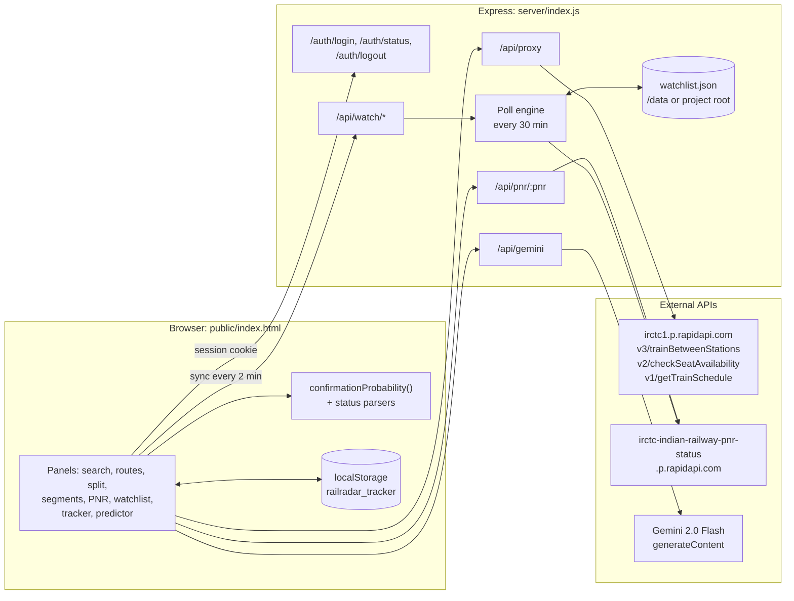
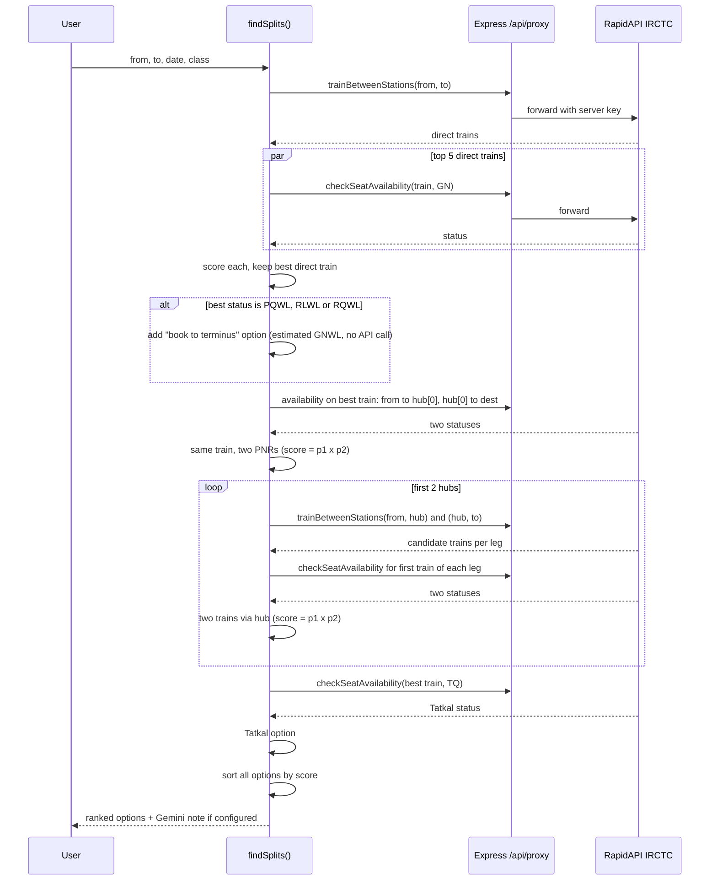

# RailRadar

Seat availability, waitlist confirmation estimates, PNR monitoring and split journey search for Indian Railways, served by a small Express backend that keeps all API keys server side.


-8E75B2?logo=googlegemini&logoColor=white)


## Why

A waitlisted ticket on IRCTC tells you a position and nothing else. Whether `PQWL 12` is worth holding, whether boarding one station earlier gets you a better quota, or whether two shorter tickets beat one long one are questions people usually answer by trial and error on the booking site. RailRadar runs those checks in one place: it queries availability for the direct trains, alternate origins and interchange hubs, scores every option with the same confirmation model, and ranks them. It also watches PNRs in the background so you do not have to keep refreshing.

## Features

| Panel | What it does |
| --- | --- |
| Find Trains | Lists trains between two stations and fetches availability for the selected class and quota (General, Tatkal, Premium Tatkal). Other classes load on demand per train to save API calls. Each result shows a confirmation probability. |
| Route Planner | Ranks up to 8 options: top 3 direct trains, alternate origin stations in the same city, "book to terminus" for PQWL/RLWL tickets, and two train splits via up to 3 interchange hubs. |
| Split Journey | For one origin and destination: picks the best of the top 5 direct trains, then compares a terminus booking, the same train split into two PNRs at a hub, two different trains via hubs, and Tatkal. |
| Segment Availability | Pulls a train's schedule, then checks availability for every consecutive pair of halting stations (batches of 4) to show where along the route seats open up. Exports the table as CSV. |
| PNR Status | Live PNR lookup with per passenger status and confirmation probability. |
| Watchlist | Server side PNR monitor. Polls every 30 minutes, records status changes as alerts, persists to disk, and raises a browser notification and toast when a status changes. |
| WL Tracker | Plots waitlist position over time for tracked PNRs (last 50 points each), stored in the browser. |
| Predictor | Manual calculator: enter quota, position, days to departure, class and route demand to get a probability and a projection at T-30, T-7, T-3, T-1 and chart time. |
| Quota Guide | Static reference for GNWL, PQWL, RLWL, TQWL, RQWL and RAC. |
| Gemini advice | When a Gemini key is configured, waitlisted results get a short situation / what to watch / action note. Responses are cached in memory per prompt. |
| Demo mode | Without a RapidAPI key the UI still works on built in sample trains and simulated availability. |

Access is gated by a PIN checked on the server (constant time comparison, 5 failed attempts per 15 minutes per IP, 12 hour session cookie).

## Architecture



The frontend is a single HTML file with inline CSS and JS, no build step. It never sees an API key: it calls `/api/config` to learn whether RapidAPI and Gemini are configured and routes every upstream request through the server. `/api/proxy` only forwards paths that start with `/api/`, and every data route requires an authenticated session.

## How the confirmation probability works

`confirmationProbability(quotaType, wlPosition, daysOut, class, routeType)` is a heuristic model, not a trained one. When the availability response includes an IRCTC prediction percentage, that value is shown instead (labelled "IRCTC Live" in exports, "Model Est." otherwise).

1. **Base rate by quota**: GNWL 0.72, RLWL 0.35, PQWL 0.22, TQWL 0.08, RQWL 0.04. CNF is 1.0, RAC is 0.92, unknown status is 0.
2. **Position decay**: a step multiplier per quota. For GNWL it goes from 0.99 at positions 1 to 5 down to 0.06 beyond 120. PQWL and RLWL fall off much faster.
3. **Time to departure**: x1.35 on chart day (capped at 0.97), x1.20 within a day, x1.10 within 3 days, x1.05 within 5, x0.85 beyond 30 days, x0.75 beyond 60.
4. **Class**: SL 1.15, 2S 1.10, CC 1.08, 3A 1.0, 2A 0.90, 1A 0.75.
5. **Route demand**: popular 0.90, moderate 1.0, lean 1.20. Search panels always use "popular"; the Predictor lets you choose.
6. The result is clamped to the range 0.02 to 0.97.

For a multi leg option the score is the product of the leg probabilities, which assumes the legs confirm independently.

## How split journeys are found

Interchange hubs come from a hand maintained `CORRIDOR_HUBS` table keyed by `FROM-TO` (either direction), for example `SC-HWH` uses `BZA, VSKP, BBS`. Pairs not in the table fall back to `BZA, KPD, NGP, GTL`.



The Route Planner follows the same pattern with a wider net: top 3 direct trains, up to 2 alternate origin stations from the same city group (for example `SC`, `HYB`, `KCG` for Hyderabad), and up to 3 hubs, then returns the top 8.

## Configuration

All configuration is through environment variables on the server. Never commit real values.

| Variable | Required | Purpose |
| --- | --- | --- |
| `RAPIDAPI_KEY` | For live data | RapidAPI key subscribed to the [IRCTC API](https://rapidapi.com/irctc1/api/irctc1) and the IRCTC PNR status API. Without it the app runs in demo mode. |
| `GEMINI_API_KEY` | No | Key from [Google AI Studio](https://aistudio.google.com/). Enables Gemini advice. |
| `ACCESS_PIN` | Yes in practice | PIN for the login screen. Defaults to `1234` if unset, so always set it on a public deployment. |
| `SESSION_SECRET` | Recommended | Session signing secret. If unset a random one is generated per boot, which logs everyone out on restart. |
| `STORAGE_PATH` | No | Directory for `watchlist.json`. Defaults to `/data` if it exists, otherwise the working directory. |
| `PORT` | No | Defaults to `3000`. |
| `NODE_ENV` | No | Set to `production` to mark the session cookie `Secure` (HTTPS only). |

Example `.env` (already in `.gitignore`):

```bash
RAPIDAPI_KEY=your_rapidapi_key
GEMINI_API_KEY=your_gemini_key
ACCESS_PIN=choose_a_pin
SESSION_SECRET=a_long_random_string
```

The server reads `process.env` directly and does not load `.env` itself, so export the variables in your shell or use `node --env-file=.env server/index.js` (Node 20.6+).

## Running locally

```bash
git clone https://github.com/fakubwoy/railradar.git
cd railradar
npm install
export RAPIDAPI_KEY=... ACCESS_PIN=...   # optional; omit RAPIDAPI_KEY for demo mode
npm run dev                              # node --watch, or `npm start`
```

Open http://localhost:3000 and enter the PIN. Do not use `NODE_ENV=production` over plain HTTP locally, since the session cookie will then require HTTPS.

## Deployment

The repo includes `railway.toml` for [Railway](https://railway.app) (Nixpacks build, `npm start`, restart on failure up to 3 times).

1. Create a Railway project from this GitHub repo.
2. Add the environment variables above under **Variables**. Set `NODE_ENV=production`.
3. Attach a Volume mounted at `/data` so the PNR watchlist survives redeploys. Without it the watchlist is lost on every deploy.
4. Open the generated URL. The sidebar shows the live data indicator when the RapidAPI key is accepted.

Any Node 18+ host works the same way: `npm install && npm start` with the variables set. Static hosting such as GitHub Pages will not work, because the frontend depends on the server routes.

## Project structure

```
railradar/
├── server/
│   └── index.js        # Express app: PIN auth, API proxies, PNR poll engine, static hosting
├── public/
│   └── index.html      # The app: markup, styles and all client logic in one file
├── index.html          # Older standalone build that read keys from config.js; not served
├── package.json        # express, express-session, express-rate-limit, node-fetch
├── railway.toml        # Railway build and deploy settings
└── .gitignore          # node_modules, .env, config.js, logs
```

## Limitations

- **API quota**: one Find Trains search costs 1 call plus 1 per train listed. A Split Journey search can use around 15 calls and a Route Planner search more. Free RapidAPI tiers run out quickly. Calls are spaced with small delays but there is no response cache.
- **Estimates, not predictions**: the probability model uses fixed heuristic weights, not historical data. The "book to terminus" option estimates the GNWL position as the current position plus a constant (6 or 8); it does not query availability to the terminus.
- **Split coverage**: hubs come from a static table, and for each hub only the first train returned per leg is checked. Connection times between legs are not validated, so the 2 hour buffer advice is up to you.
- **Data accuracy**: everything depends on the third party RapidAPI providers, whose response shapes have changed before (the parsers handle several). The main PNR response shape has no passenger names, so passengers are shown as "Passenger 1", "Passenger 2".
- **Alternate origins**: the alternate origin check uses train numbers from the built in sample list, so it is only meaningful on the corridors that list covers.
- **Single user design**: the watchlist is one shared list per server, not per user, and the poll engine runs in process.
- **WL Tracker** history lives in `localStorage`, so it is per browser and disappears if site data is cleared.

## Disclaimer

RailRadar is an independent personal project. It is not affiliated with, endorsed by or connected to IRCTC, Indian Railways or CRIS. Availability and PNR data come from third party APIs and may be delayed or wrong. Confirmation percentages are estimates. Always verify on the official IRCTC website or app before booking or travelling.
